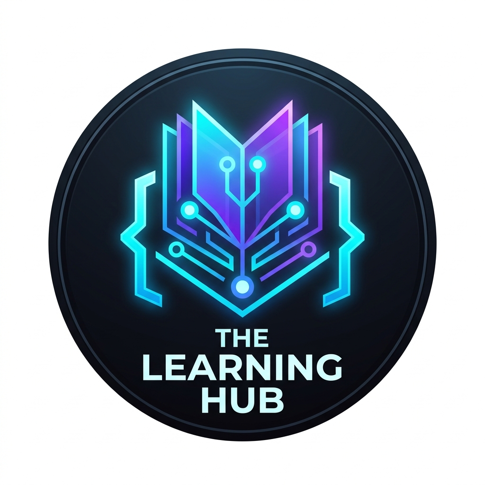

# The Learning Hub

**The unified, enterprise-grade open source curriculum platform for modern developers.**  
*76+ Production-Grade Guides • Exhaustive 7-Stage Roadmaps • Staff Architect Interview Handbooks*

 

---

### 🗺️ The 8 Core Engineering Disciplines

1. **🤖 AI, LLMs & Autonomous Agents (18 Guides)**: `learn-mcp`, `learn-claude`, `learn-openai`, `learn-gemini`, `learn-deepseek`, `learn-ollama`, `learn-vllm`, `learn-vercel-ai-sdk`, `learn-langgraph`, `learn-crewai`, `learn-autogen`, `learn-rag`, `learn-vector-databases`, `learn-prompt-engineering`, `learn-structured-outputs`, `learn-ragas`, `learn-langfuse`, `learn-promptfoo`
2. **🎨 Frontend & UI Frameworks (13 Guides)**: `learn-angular`, `learn-reactjs`, `learn-nextjs`, `learn-svelte`, `learn-react-native`, `learn-vue`, `learn-astro`, `learn-html`, `learn-css`, `learn-scss`, `learn-tailwindcss`, `learn-bootstrap`, `learn-rxjs`, `learn-ngrx`
3. **⚙️ Backend, APIs & Runtimes (10 Guides)**: `learn-fastapi`, `learn-nodejs`, `learn-expressjs`, `learn-nestjs`, `learn-deno`, `learn-bun`, `learn-kafka`, `learn-graphql`, `learn-dot-net`, `learn-javascript`
4. **🗄️ Databases, Caching & BaaS (9 Guides)**: `learn-postgresql`, `learn-mysql`, `learn-sql`, `learn-mongodb`, `learn-redis`, `learn-prisma`, `learn-drizzle`, `learn-supabase`, `learn-firebase`
5. **☁️ DevOps, Cloud & Infrastructure (8 Guides)**: `learn-docker`, `learn-kubernetes`, `learn-linux`, `learn-git`, `learn-github-actions`, `learn-terraform`, `learn-aws`
6. **🧪 Testing, Protocols & Web Security (7 Guides)**: `learn-playwright`, `learn-vitest`, `learn-cypress`, `learn-websockets`, `learn-grpc`, `learn-rest-api`, `learn-web-security`, `learn-oauth`
7. **💻 Programming Languages (7 Guides)**: `learn-typescript`, `learn-python`, `learn-rust`, `learn-go`, `learn-c`, `learn-c-plus-plus`, `learn-c-sharp`
8. **📐 System Design & Computer Science (3 Guides)**: `learn-system-design`, `learn-data-structures-algorithms`, `learn-design-patterns`

---

  Maintained with ❤️ by <a href="https://github.com/manthanank">@manthanank</a> and contributors.

